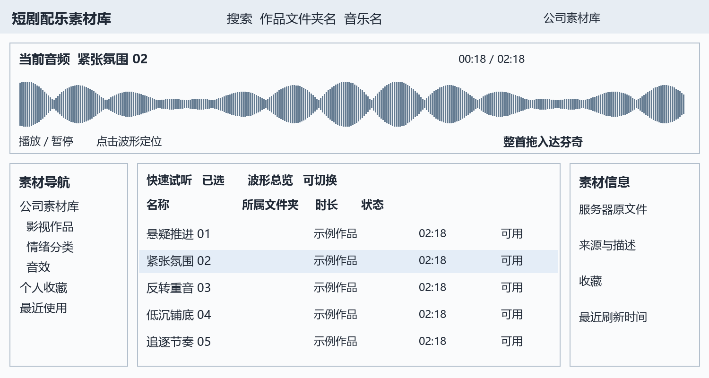
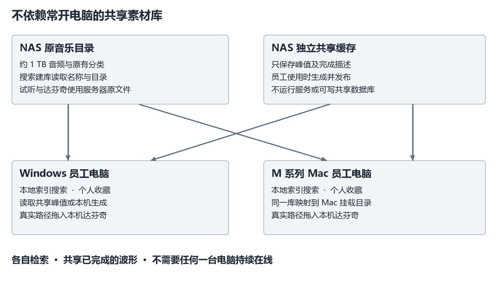

# 短剧配乐音频素材管理器开发文档

> **历史规格，当前要求已修订。** 请以 [当前需求与 0.7 验收范围](current-requirements-0.7.md) 和 [实施记录](implementation-status.md) 为当前入口。本文保留 1.2 的设计背景；默认大波形、深色布局、波形与外拖分区及原阶段排期已被后续用户需求取代。本文的功能目标与性能数字不代表已经交付或验收。

产品需求与技术设计　版本 1.2　2026 年 9 月 20 日

本文件用于开发一款支持 Windows 和 Mac 的短剧配乐音频素材管理器，服务于约 1 TB 公司共享音乐库和 6 至 10 名使用者。首版重点是按文件夹名与音乐名搜索、查看波形、快速试听，以及将整首音乐拖入达芬奇并继续引用服务器原文件。

确定的部署方式是每台电脑保留自己的搜索索引，服务器只保存原音乐和独立共享波形缓存，不要求额外常开电脑或安装后台服务。员工打开软件时按需生成和共享波形，所有人退出后后台处理自然停止。共享缓存减少重复读取，但不能保证首次访问从不重复解码，也不能消除 NAS 的网络和磁盘延迟。

本版根据用户最新确认取代 1.1 版的实施方案。原先的 Windows 专用界面、常驻索引服务、强制复制到项目和首版片段导出均已调整。1.1 版中的出片与 Resonic 调研仍是参考资料。本文中的性能数字和工期是待验证目标与估算，不是已实现的结果。

## 1 已确认的需求和环境

| 项目 | 确认内容 | 实施影响 |
| --- | --- | --- |
| 音频库 | 约 1 TB，位于公司 NAS 或共享服务器 | 保留现有文件与目录，不复制整库 |
| 使用者 | 6 至 10 人，包含 Windows 和 Mac | 以 10 客户端验收，双平台从原型开始验证 |
| 常开设备 | 公司无法提供额外常开电脑 | 首版没有中央服务依赖 |
| 共享缓存 | 可新建独立文件夹，大家能够读写 | 共享不可变峰值文件，不共享可写数据库 |
| 达芬奇交付 | 整首拖入，继续引用服务器原文件 | 默认不复制、不裁切，不移动原件 |
| 旧软件数据 | 不需要迁移收藏、标签和颜色分类 | 从现有目录重新建索引 |
| 搜索习惯 | 文件夹名称与音乐名称 | 目录匹配必须能找到其下音乐 |
| 情绪理解 | 希望后续可自动识别音乐情绪 | 作为独立增强能力，首版不依赖模型 |
| Windows 电脑 | 实查 Windows 11，Ryzen 5 9600X，约 31.6 GiB 内存 | 用作 Windows 原型与基线机器 |
| Mac 电脑 | 用户提供 M4 Pro、48 GB、macOS 27 | Apple Silicon 为首版目标；系统版本与兼容性待实机确认 |
| Resolve | 用户使用 20 或 21，本机文件版本实查 20.3.2.9 | 按平台、准确版本和工作页面分别验收 |

尚需在接入时登记的是共享根目录与缓存目录的具体位置、网络条件、是否存在分组访问权限，以及 Mac 上的 Resolve 准确版本。这些属于配置和实机验证，不再重新询问已经明确的产品范围。缓存可读写并不等于所有人对所有音乐拥有相同权限。

本次未对生产 NAS 做负载测试、未改动原音乐、未向达芬奇工程导入素材。macOS 27 是用户提供的信息，当前没有该 Mac 的系统报告，不记为已验证兼容。Intel Mac 暂不纳入必须交付的首版安装包。

## 2 参考软件与产品方向

出片 5.7.0 的现场界面提供素材树、名称、列表波形、时长和搜索等入口，当前根目录计数为 28,943；这不是对整个服务器的正式清点。官网旧版更新已经提到数据库及本地波形缓存，因此新产品的优势必须通过调度、复用与实测体现，不能仅用“有缓存”解释。[S1][S2]

Resonic Player 0.9.3 的现场界面使用轻量文字列表和当前音频的大波形。已验证 Ctrl+F 在当前 20 条列表中筛选文件名，输入 Things 得到 4 条，清空后恢复。它不等同于本方案的全库持久索引搜索。官方 FAQ 也区分列表筛选与较昂贵的子目录递归扫描；历史功能计划不作为已交付能力。[S14][S16]

新软件采用简洁列表、当前音频大波形和常驻试听引擎，同时提供可切换的列表波形总览。本次没有完成两款软件的同条件计时；原生组件、缓存文件存在或当前目录较小，都不能单独证明快的根本原因。

## 3 首版功能与明确边界

| 编号 | 功能 | 首版范围 | 核心验收 |
| --- | --- | --- | --- |
| F01 | 共享目录与本地目录接入 | 必须 | Windows 与 Mac 能映射同一逻辑素材库 |
| F02 | 本地持久索引 | 必须 | 查询不实时遍历服务器 |
| F03 | 文件夹名与音乐名搜索 | 必须 | 中文两字、子目录、多个关键词与重名 |
| F04 | 当前大波形及列表波形开关 | 必须 | 波形加载不阻塞搜索和试听 |
| F05 | 试听、定位、切曲 | 必须 | 低等待、可停止、不串音 |
| F06 | 新收藏与个人标签 | 基础功能 | 本地保存、可备份，不写入原件 |
| F07 | 整首拖入达芬奇 | 必须 | 默认引用服务器原件，目标应用只读使用 |
| F08 | 片段导出与拖入 | 延后 | 不属于首版验收 |
| F09 | 无服务共享波形缓存 | 必须 | 有效缓存可跨电脑复用，断开可退化 |
| F10 | 离线、断网与权限状态 | 必须 | 搜索旧目录可用，不把断网当删除 |
| F11 | 本机项目副本 | 可选操作 | 用户主动使用时永久保留，默认关闭 |
| F12 | 共享标签编辑 | 延后 | 首版个人标签不协同写入 |
| F13 | BPM、调性与响度分析 | 后续增强 | 不阻塞首版核心链路 |
| F14 | 自动情绪理解与相似音乐 | 后续增强 | 人工样本评估后另行决定 |
| F15 | 原文件移动删除重命名 | 延后 | 首版不改变公司的文件组织 |
| F16 | Windows 与 Apple Silicon Mac | 必须 | 双平台真实素材和 Resolve 验收 |

首版不做 DAW、云音乐下载、自动整剧配乐、旧软件数据迁移或公司账号平台。普通关键词搜索先检索已有文字；不能把从目录“伤感”推断出的分类伪装成听懂了音乐。

## 4 用户流程和界面

### 4.1 默认工作区

顶部始终显示搜索框、搜索范围和视图切换；搜索下方是当前音频的大波形与播放控制。左侧为素材目录、收藏和最近使用，中间为结果，右侧是可折叠信息区。默认深色并支持浅色、高 DPI 与 Retina，图示仅表达布局。

默认快速试听视图只显示名称、所属文件夹、时长和状态，不请求每行波形。切到波形总览后才按需加载可见行的缩略峰值。切换视图保留搜索、选择和播放位置。首版波形用于跳转和观察，不提供导出入出点交互。

### 4.2 找音乐到拖入工程

1. 首次分别选择本机可访问的音乐共享根目录和独立缓存目录；软件先收录名称和路径。
2. 输入文件夹名、音乐名或多个关键词；先出现可点击结果，时长与波形可以稍后补齐。
3. 单击选择，空格播放或暂停，点击大波形跳转；上下键换候选。可开启“选中后试听”，默认关闭悬停自动播放。
4. 从文件名或拖动手柄将整首音频拖入达芬奇；输出当前电脑能访问的原文件路径，不等待波形生成或文件复制。
5. 达芬奇工程继续引用服务器原件；软件明确显示“服务器原文件”。可选“复制到项目”是独立操作，不自动改变默认方式。

文件拖动和波形跳转使用不同区域，避免拖动音乐时误改播放位置。Windows 用 Ctrl+F，Mac 用 Command+F 聚焦搜索；输入框聚焦时不截获普通字母。拖放默认只提供 Copy 行为，绝不让目标应用触发源文件移动。

### 4.3 常见状态

| 状态 | 界面表达 | 行为 |
| --- | --- | --- |
| 初次收录 | 已发现条数、正在处理目录 | 已发现的记录立即可查 |
| 波形未准备 | 当前波形正在准备 | 可先试听，不阻塞其他条目 |
| 缓存目录不可写 | 共享缓存暂不可用 | 使用本地缓存，继续读音乐 |
| 音乐共享断开 | 显示上次目录和最后更新时间 | 继续搜索，未缓存音频不能播放或拖入 |
| 原件不可读 | 无权限或文件位置已变化 | 保留信息，提供刷新当前目录 |
| 共享缓存异常 | 本地重新生成或忽略该缓存 | 不导致客户端退出 |

## 5 性能目标和测量口径

以下数字是 P0 原型需要验证的目标。Windows 以用户电脑为基线，Mac 以用户提供的 M4 Pro 电脑实测；结果分开报告。网络基准先使用有线千兆与稳定共享存储，实际无线及繁忙 NAS 另组测量，不能混合给出一个速度结论。

| 操作 | 建议目标 | 条件和边界 |
| --- | --- | --- |
| 热搜索首屏 | P95 ≤ 150 ms，P99 ≤ 300 ms | 10 万条本机索引，提交至 50 行可交互 |
| 输入到结果 | P95 ≤ 300 ms | 含约 120 ms 防抖，取消过期查询 |
| 启动可搜索 | P95 ≤ 3 s | 已建库，不等网络连接检查 |
| 本地缓存当前波形 | P95 ≤ 200 ms | 峰值命中，含读取与绘制 |
| 共享缓存当前波形 | P95 ≤ 1 s | 缓存有效、共享在线，响应数据有界 |
| 列表缩略波形 | 本地首屏 P95 ≤ 300 ms | 50 行，波形总览模式，批量读取 |
| 热音频起播 | P95 ≤ 150 ms | 命令到音频设备首个有效样本 |
| NAS 冷音频起播 | P95 ≤ 1 s | 指定格式和正常网络，单独报告 seek |
| 拖拽启动 | P95 ≤ 100 ms | 已解析可读路径；不计达芬奇自身导入耗时 |
| 稳态进程总内存 | 目标 ≤ 600 MiB | 10 万条、50 可视行，含音频子进程 |
| 内存峰值 | 目标 ≤ 1 GiB | 大文件、快速切曲与波形生成压力 |
| 交互绘制 | 接近 60 fps | UI 帧处理 P95 ≤ 16.7 ms，分别测两个平台 |

未准备过的完整波形没有瞬时完成承诺。先显示已完成区段或低分辨率轮廓，明确进度；“出现部分波形”和“全曲波形完整可用”分别计时。缓存条目和当前媒体读取不得成为播放前的串行等待链。

10 客户端持续搜索且交替试听时，搜索链路仍只访问各自本机索引；热搜索 P95 相对各自单机基线退化目标不超过 20%。测试分别记录后台扫描和波形生成的网络字节，不能把全部 NAS 流量归为搜索流量。正常查询不直接启动目录扫描或音频解码。

首次建库按目录枚举条数每秒、元数据读取量和索引完成时间报告。首次全库波形若完整读取 1 TB，在 80 MB/s 下理论约需 3.5 小时，尚未计解码与文件操作；首版默认不自动全库预处理。所有结果报告中位数、P95、P99、失败率、缓存状态和样本数。

## 6 无常开服务的系统架构

### 6.1 各组件职责

每台客户端拥有本地 SQLite 搜索数据库、本地个人数据、本地热点波形和一个活动试听会话。NAS 的原音乐目录保持现状，另建独立缓存根目录保存峰值文件和少量完成描述信息。NAS 不运行本软件服务；客户端之间不开放监听端口，也不要求某位同事先开机。

名称和目录索引首先由各客户端根据自己能够访问的源目录建立。这样首次元数据扫描仍可能重复，但正常搜索不读取 NAS。首版不默认发布全公司文件名快照，以免把某个账号能看到的目录暴露给其他账号；后续确认权限一致后，才评估共享只读目录快照。

波形按“本地有效缓存 → 共享有效缓存 → 本机生成并发布”的顺序取得。所有员工都关闭软件后，索引刷新和波形生成停止；新文件在下一次客户端扫描发现后出现。没有固定在线节点，就不能承诺全天实时发现变化或所有冷请求严格只解码一次。

### 6.2 技术选型

推荐 Qt 6、C++20、CMake、SQLite FTS5、独立音频工作进程与 FFmpeg 解码库。界面先采用 Qt Widgets 的模型视图表格与自绘波形，数据分页和绘制缓存由应用明确控制。选择依据是 Windows 与 macOS 共用业务代码、原生文件拖放及音频模块边界清楚；使用 C++ 本身不是性能保证。[S5][S18][S19]

WPF 不再是首选，因为当前需求包含 Mac。P0 在两个平台分别验证音频输出和文件拖放，再锁定 Qt 与解码组件版本。Qt 当前官方平台文档列出 Windows 和 macOS 的支持范围，但不能据此认定用户提供的 macOS 27 已经过本产品验证。[S18]

| 模块 | 方案 | 独立约束 |
| --- | --- | --- |
| 界面 | Qt Widgets、模型视图、自绘波形 | 不在 UI 线程扫描、解码或访问 SMB |
| 搜索 | 本地 SQLite FTS5 与应用层中文 token | 数据库仅在本机磁盘 |
| 音频 | 常驻工作进程、FFmpeg 增量解码 | 有界缓冲、可取消、可恢复 |
| 输出 | Qt 音频输出接口，必要时平台适配 | Windows 与 Mac 分别测试设备与共存 |
| 外拖 | QDrag、QMimeData 与本地文件 URL | 必须在目标 Resolve 实测 |
| 共享缓存 | 普通目录中的不可变文件 | 不运行共享数据库，不依赖 HTTP 服务 |

SQLite 官方对 WAL 的跨主机网络文件系统使用有限制，本方案禁止把活跃 SQLite 数据库放到 SMB 让多台电脑打开。[S6] Qt 的文件拖放和音频接口提供实现基础，不代表 Resolve 兼容性或起播速度已经达标。[S19][S20][S21]

## 7 文件夹与音乐名搜索

### 7.1 查询语义

普通查询同时匹配音乐名、相对路径中的各级文件夹名、个人标签和可用描述。多个空格分隔词默认 AND，可以分别命中不同字段。默认不将服务器地址、盘符或挂载点名称作为音乐检索内容，避免不同电脑得到不同结果。

| 输入或操作 | 预期行为 | 边界 |
| --- | --- | --- |
| 输入作品文件夹名 | 返回该目录及子目录内的音乐 | 搜索框持续显示当前范围 |
| 输入音乐名 | 匹配文件名及已有标题信息 | 同名文件保留所属目录 |
| 输入作品名和歌名 | 同时满足两个词 | 可分别命中目录与文件名 |
| 输入中文两字 | 正常返回相关记录 | 不要求至少三个汉字 |
| 选择当前目录 | 可切换包含子目录或仅本层 | 默认包含子目录 |
| 点击目录结果 | 进入对应逻辑目录 | 不对 NAS 做递归重新搜索 |

默认主列表显示音乐结果，可提供单独的“文件夹”结果页或建议项。文件夹数量来自本地索引，精确数量未完成时不阻塞首屏。文件夹匹配导致大量歌曲命中时，先返回首屏并支持稳定分页，不为了算总数阻塞操作。

### 7.2 中文索引与排序

不能把 FTS5 默认 tokenizer 当成完整中文分词；trigram 本身也无法独立满足中文两字子串需求。[S5] 建议应用预先生成汉字单字及相邻双字 token、拉丁词和规范化文本；查询候选再按原始连续文本确认短语或子串。

搜索字段做 Unicode 规范化、英文大小写折叠和常用标点处理，但真实文件路径必须保真，不因规范化而合并两个不同文件。精确文件名、文件名前缀、目录和标签分别设排序层级，再使用相关性、个人收藏等辅助排序。目录改名后重建受影响子树的可检索路径文本。

查询携带 query_id、index_generation、scope 和 cancellation，返回前 50 行及稳定游标。后台索引更新时保持当前页并提示可刷新，旧请求不得覆盖新结果。采用参数化数据库调用，用户文本不直接拼接为 SQL 或 FTS 语法。

## 8 建库与目录变化

首次扫描只枚举相对路径、大小、修改时间和类型，分批提交后立即可搜索；时长、格式和标签后台补齐。目录扫描每台初始并发 1、媒体探测并发 1，避免 10 台电脑同时按 CPU 核心数打开大量远程文件。

启动扫描加入 30 至 120 秒随机延迟，用户主动刷新当前目录时立即提升该范围优先级。已有索引直接显示，不等待网络。后台按目录轮转对账，初始目标约 15 分钟一轮调度，实际完成时间随目录规模和 NAS 繁忙程度变化。界面显示最后成功刷新时间；不将 15 分钟调度写成严格全库实时性保证。

文件系统通知只作加速信号，Windows 和 Mac 的远程共享通知都须实测，最终以成功枚举对账兜底。Windows 官方文档列有远程目录通知的限制。[S10] 父目录时间戳不能代替对所有子目录变更的检测。

只在某目录完整枚举成功后评估缺失条目；断网、权限拒绝、扫描取消和超时不算删除。疑似缺失经两次成功复查且超过 24 小时再转为不可用，保留收藏关联和历史路径。当前文件确实打不开时可即时显示不可用，但不能据此清空整个库。

## 9 共享波形缓存

### 9.1 身份和文件格式

缓存目录有独立的库配置，包含随机 library_id 和格式版本；首次配置以独占创建初始化，已存在时读取校验而不覆盖。每台电脑把同一 library_id 映射到自己的共享根路径。缓存键包含库、保真的相对路径身份、源版本描述、峰值算法版本、声道处理方式和精度档位。

源版本描述以大小、高精度修改时间和媒体信息快速筛选，当前文件或待生成文件可追加小范围内容指纹检查。该指纹不能证明未抽样区域没有变化；需要强校验时执行完整内容校验。完整内容哈希在已有完整读取过程中或用户显式校验时生成，不为每次绘制波形重读整首文件。

峰值保存各声道的 min/max，禁止先混为单声道导致反相抵消。缩略图最多 2,048 桶；详细波形采用每 256 个采样点一桶的基础层及逐层 4 倍聚合。缓存头包含采样率、实际采样数、声道布局、版本、量化格式、长度和校验值。精度不足时再读取当前时间窗，不把插值称作逐采样波形。

### 9.2 并发生成和发布

首版优先采用容易验证的不可变输出流程，不要求跨机数据库或复杂的分布式锁。请求共享缓存未命中时先短暂随机退避并再次检查；本机对相同缓存键合并任务。仍未命中即可自行生成，允许少量跨电脑重复工作，正式报告须测量这一比例。

每个生成者将文件写入自己的 UUID 临时目录，完成、校验后发布唯一对象名，最后发布小型完成描述文件。描述文件与对象采用同一共享文件系统内的改名发布，并在真实 NAS 上验证可见性；读者只接受完整描述、匹配版本、精确长度和有效校验的对象。若 NAS 不满足必要语义，停止共享发布并回退本地缓存。

同一缓存键出现多个有效输出时按固定规则选择兼容对象，其他对象作为可清理重复项；不让多个客户端覆盖同一个半成品。断网、崩溃或退出留下的临时文件不会成为有效缓存。源文件生成前后检查版本，若变化则丢弃该结果。完整媒体校验仍是强一致验证的最终手段。

不承诺“10 人同时第一次点开只能解码一次”。若真实负载表明重复量过高，再单独验证 SMB 原子占用或短期任务协调机制；该增强不能成为首版正确性的前提。

### 9.3 权限和容量

共享峰值与描述会泄露时长或声音形状，因此权限范围要与源素材保持一致。首版仅在已确认同权限的库范围开启共享缓存；其他范围使用本地缓存。仅凭所有人可以写同一个缓存目录，不能认定所有源目录都可公开。

| 数据 | 初始预算 | 清理规则 |
| --- | --- | --- |
| 本机峰值 | 5 GiB，可调整 | 按最近使用淘汰，正在使用的跳过 |
| 可选试听音频缓存 | 10 GiB，可关闭 | 可回收，不作为默认外拖路径 |
| 共享峰值目录 | 初始 50 GiB，可调整 | 按统计核定，首版由指定人员执行清理 |
| 个人数据库与备份 | 独立于峰值 | 不随缓存清理删除 |
| 可选项目副本 | 用户指定空间 | 永不自动淘汰 |

共享目录达到容量阈值后停止新的后台发布，仍允许读已有缓存和本地生成。各客户端不同时做共享垃圾回收。提供缓存管理工具，先列出候选并检查活动任务；运行中读者遇到对象被移除时可重新生成，不影响原音乐。容量阈值在无协调服务下是软限制，必须留并发余量，不声称严格全局配额。

## 10 播放和资源调度

每台客户端只保留一个活动试听会话。常驻音频工作进程负责增量解码与设备输出，避免每次切曲串行启动探测程序。音频信息缺失时先解析播放所需内容，再后台补齐其它信息；完整波形、全曲分析和情绪模型都不在起播前置条件中。

每次选曲增加 playback_generation，旧缓冲停止输出，所有事件检查代号后才更新界面。关闭当前解码器可能阻塞时不得卡住 UI；超时回收工作进程并恢复。音频缓冲、解码任务、峰值绘制和日志均有上限，长文件不一次展开到内存。

优先级为当前音频输出、用户定位、当前波形、可见缩略波形、后台探测。每台初值允许一个交互读取和一个后台读取，后台网络读取初始限速 1 MB/s，可暂停或调整。10 台机器的独立限速不能保证全公司总流量严格受控；测试须观察 NAS 总负载并决定是否需要更低默认值。

默认不自动遍历 1 TB 并生成全部波形。用户访问过的音频逐渐进入共享缓存；批量预热是明确选择的操作，并显示负载和进度。没有常开机器时，夜间任务不能保证完成，退出程序要保存进度并在以后恢复。

首版测试 MP3、WAV、AIFF、FLAC、OGG，另验证 M4A/AAC、Opus 与特殊 WAV；覆盖 44.1、48、96 kHz、单声道与双声道。多声道显示布局，试听下混规则明确。默认不归一化或改变源文件音量。输出设备热插拔及与 Resolve 同时播放在两个平台独立验收。[S21]

## 11 跨平台路径与达芬奇拖放

### 11.1 路径映射

Windows 使用 UNC 或映射盘，Mac 使用用户已经挂载的共享目录；同一服务器音乐在两台电脑上的绝对路径通常不同。库逻辑身份与相对路径用于定位，本机适配器解析出该平台可读的完整路径。不能直接把 Z 盘路径发给 Mac，也不能假设所有 Mac 都挂载到同一个名称。

遇到共享未挂载、挂载目录改名或相对路径含异常跳转时停止外拖并给出重新定位入口。保留实际文件名的 Unicode 与大小写形式；搜索规范化不改变真实路径。不同素材库不可仅因显示名称相同而合并。

### 11.2 整首外拖

通过 QDrag 和 QMimeData 传递由本机现有文件路径创建的文件 URL，并将允许操作限制为复制或引用。[S19][S20] Windows 验证原生 CF_HDROP 文件列表，Mac 验证系统文件 URL 在 Resolve 中被正确接受；若框架转换不足，使用小型平台适配层，不改变核心数据模型。[S8]

默认外拖的始终是 NAS 原件，不是共享峰值、预览代理或易清理的临时音频。文件可读性在选择时异步检查，拖动开始时利用近期状态；网络卡住时可取消并显示连接状态，不在拖动回调中无限等待。

播放与波形是否完成不影响整首外拖。Resolve 导入后由其决定工程引用和内部缓存行为，软件记录“已拖出”而不是“工程已保存”。必须保存并重开工程，确认引用仍指向预期的服务器原件。

### 11.3 项目持续使用

服务器原件被移动、改名、断开或权限撤回时，原工程可能需要重新链接，这是默认引用方式的结果；软件不能保证 NAS 不在线时工程仍能读取音频。此说明放在首次选定交付方式与连接状态中，不在每次拖拽时重复弹窗。

可选“复制到项目”先完成校验后的稳定文件，再允许外拖；该副本独立于试听缓存，清理和卸载不自动删除。首版不自动更改已有 Resolve 工程引用。Windows 与 Mac 之间交接同一工程时，路径映射与 Resolve 重链接属于独立验收项，不能因两端都能导入就认定工程跨机直接可用。

## 12 数据模型与本地存储

| 实体 | 关键字段 | 规则 |
| --- | --- | --- |
| Library | library_id、name、cache_format | 同一共享缓存配置提供稳定身份 |
| RootMapping | library_id、local_root、platform | 只保存本机路径映射，不当成跨机地址 |
| Folder | local_id、parent_id、relative_path、scan_state | 记录扫描完成状态和错误 |
| Asset | asset_id、library_id、relative_path、status | 本机永久 ID，不直接由可变路径替代 |
| SourceVersion | size、mtime、fingerprint、full_hash | 区分快速变化线索与完整校验 |
| AudioInfo | duration、sample_rate、channels、codec | 绑定源版本，不用零时长冒充未知 |
| WaveformEntry | key、profile、object_hash、state | 绑定源版本与生成算法 |
| PersonalData | asset_id、tags、favorite、last_used | 个人数据独立备份 |
| LocalJob | id、kind、generation、progress、state | 有界队列、可恢复、可取消 |
| ScanCursor | root、folder、last_success、generation | 断网与未完成扫描不得推进成功游标 |

源文件改名可通过可靠文件身份或候选内容指纹辅助关联；无法确认时保留旧关联并提示，不把相似名字自动当成同一音乐。共享峰值键与本机 asset_id 分离，便于不同客户端复用相同源版本的缓存。

本地分 catalog、user-data、wave-cache、preview-cache、jobs 和 logs。Windows 位于应用数据目录，Mac 位于应用支持与缓存目录，具体路径由平台接口取得。SQLite 使用事务、外键和本地 WAL；搜索表与基础元数据在同一事务或影子库切换中更新。备份使用数据库备份机制，不在活跃写入时只复制单个数据库文件。[S6]

## 13 内部接口与共享文件契约

| 接口 | 输入要点 | 输出与行为 |
| --- | --- | --- |
| Search | query、scope、filters、cursor、generation | 结果页、游标、范围和可取消状态 |
| ScanFolder | library、relative_path、include_descendants | 分批发现记录，完成状态单独提交 |
| GetWaveform | asset_version、profile、priority | 本地或共享缓存，或生成任务 |
| OpenPreview | asset_version、position、generation | 单一会话状态与设备事件 |
| ResolveDragPath | asset_id、source_version、platform | 本机真实可读源路径或明确错误 |
| StartFileDrag | validated_paths、allowed_action | 只发起系统文件拖放 |
| CopyToProject | asset_version、target_directory | 可选稳定副本任务，原件不改 |

首版不部署 REST 团队服务。跨进程通信只在本机，消息采用带 schema_version、request_id 和 playback_generation 的有界协议。限制消息长度、PCM 缓冲和错误日志；取消任务必须能停止消费者及回收资源。

共享完成描述包含 cache_schema、library_id、source_signature、waveform_profile、object_name、object_size、object_hash 和完成时间。源目录绝对地址与账号口令不写入共享描述。对象路径只允许在已配置缓存根下，拒绝越界相对路径与超大尺寸声明。描述本身完整可解析、对象完整可校验后才可用。

本机任务状态为 Queued、Running、Ready、Failed、Cancelled。未完成输出不得进入 Ready，重复本机请求按键合并。共享存在多个 Ready 对象是允许且可清理的状态，不把无服务模式误写成严格单执行者协议。

## 14 个人数据与访问权限

音乐读权限沿用操作系统当前用户的共享访问，不创建额外的公司用户系统。个人收藏和标签仅在本机生效，可导出备份；首版不修改音频内嵌标签，不迁移出片私有数据库。源目录允许只读，缓存目录写入严格限制在已选缓存根中。

同权限的素材可以使用同一共享峰值区；不确定权限范围的库默认仅本地缓存，直到完成范围核对。共享缓存被其他客户端写入并不意味着内容可信：解析长度、版本和校验值，损坏或异常对象隔离。无需要求用户逐首批准正常的缓存生成。

音频、路径、文件名和使用记录默认不上传互联网。情绪增强若未来选择外部服务，须另行明确数据范围和成本；当前版本不预设外传。凭据由系统共享挂载机制管理，日志不写口令，诊断包默认脱敏。

## 15 恢复与备份

| 故障 | 恢复行为 | 不受影响的部分 |
| --- | --- | --- |
| NAS 断开 | 暂停网络任务、退避重试、显示离线 | 本地名称搜索和个人数据 |
| 缓存不可写 | 本地生成，稍后再尝试共享发布 | 原音乐试听和外拖 |
| 音频工作进程崩溃 | 结束旧会话、重启工作进程 | 主窗口和本地索引 |
| 生成中退出 | 不发布半成品，下次恢复或重做 | 其他已完成缓存 |
| 本地索引损坏 | 保留问题库并重建影子索引 | 单独保存的个人收藏 |
| 共享对象损坏 | 忽略并生成有效本地对象 | 原音乐不改动 |
| 本地磁盘不足 | 停后台任务，提示管理可回收缓存 | 不删除项目副本和个人数据 |
| 原件移动或改名 | 标记不可用并提供重新定位 | 不自动改写 Resolve 工程 |

个人数据每天本地轮换备份，初始保留 7 份日备份和 4 份周备份。用户可设置第二位置进行备份，未配置时不声称可以抵御整机损坏。波形可以重建，共享缓存无需与业务原件同等级备份。恢复测试实际核对收藏、标签和路径关联，不只检查程序能启动。

## 16 验收测试

### 16.1 数据与平台

使用约 3 万条实际元数据建立基线，另建 10 万条与 30 万条合成索引集；合成索引不能代替 1 TB 音频的真实 I/O。音频样本覆盖 MP3 VBR、不同采样率、中文与空格文件名、重名、超长音乐、损坏文件及多声道。

Windows 11 x64 与用户 M4 Pro 分别运行同一查询与样本集。登记 Mac 实际系统版本、Qt/音频组件版本和 Resolve 版本。若 macOS 27 或目标 Resolve 尚未完成实机验证，相关矩阵保持待测，不用另一个系统版本的结果替代。

### 16.2 核心验收项

| 测试 ID | 步骤 | 通过条件 |
| --- | --- | --- |
| A01 | 搜文件夹名、歌名、两字词及组合词 | 结果符合人工标注，满足搜索时延 |
| A02 | 索引进行时快速更改关键词 | 不冻结，旧结果不覆盖 |
| A03 | 10 客户端同时搜索与交替试听 | 查询不枚举 NAS，读取量分类记录 |
| A04 | 10 人首次打开同一未缓存音频 | 输出均有效，测量重复生成比例 |
| A05 | 一台生成波形，另一平台读取 | 命中兼容缓存，不完整重解码 |
| A06 | 源内容变化、标签变化、算法升级 | 分别正确失效或复用，不混用版本 |
| A07 | 扫描中断网、退出并恢复 | 不误删目录，进度能恢复 |
| A08 | 收藏备份后重建索引再恢复 | 用户数据保留且关联可核对 |
| A09 | 两平台将整首拖入媒体池与时间线 | 声音正确、原件未移动、路径正确 |
| A10 | 保存并重开工程，清理波形缓存 | 原件在线时工程仍正常引用原件 |
| A11 | Windows 与 Mac 切换挂载根 | 库身份不变，路径重新映射正确 |
| A12 | 快速换曲、定位、插拔设备 | 不串音、不播旧请求、可恢复 |
| A13 | 不同源权限与缓存权限组合 | 不发布或读取超出授权范围的峰值 |
| A14 | 发布中断网或客户端同时写入 | 半成品不可见，有效输出不互相破坏 |
| A15 | 8 小时和约 1000 次素材切换 | 无崩溃，稳态内存及句柄无持续增长 |
| A16 | 切换快速试听与波形总览 | 播放不变，关闭后停止申请行波形 |
| A17 | 每 100 ms 切候选，连续 100 次 | 无过期音频迟到，资源能够回落 |
| A18 | 缓存不可写、满额、损坏与被清理 | 原件仍可用，能回退本地，不清业务文件 |

音频起播须以设备回环或等价可复现测量记录，点击按钮变色不代表已经出声。波形计时区分首显与完整就绪。重启应用不等于清除 Windows、macOS 或 NAS 文件缓存；各缓存层状态分开报告。

### 16.3 兼容与发布门槛

Resolve 20 与 21 的媒体池、Edit 时间线分别测试，登记 Free/Studio、准确补丁版本和系统版本。格式表只作格式预筛选，不替代拖放验证。[S11] Mac 与 Windows 原件路径、不同权限等级、离线恢复和跨机工程重链接单独记录。

任一情况阻止对应平台正式发布：源文件被移动或改动；缓存清理误删业务文件；无权限元数据泄露；核心查询确定性漏召回；旧音频串入新选择；已在线原件在工程重开后失去引用；目标平台未实际跑通核心链路。单平台原型可先演示，但不标为双平台正式版。

## 17 安装和运维

交付 Windows x64 与 macOS arm64 安装包，依赖版本锁定，普通员工账户可运行；Mac 需要实际构建与设备测试条件，不能仅在 Windows 上宣称完成。安装包签名、Mac 分发验证和可回滚更新作为发布任务，具体证书由交付主体配置。

首次向导只需要音乐根目录、缓存目录和库身份。缓存区初始化、容量统计与权限检测都有可见结果，不替用户创建常开服务。缓存不具备写权限时允许先以本地模式使用，再修复配置。

记录搜索时延、播放起播、峰值命中率、重复生成比例、队列长度、网络读取量和可用空间。日志默认只记录资产 ID 与错误码。退出软件取消后台工作并保留可恢复进度；不在剪辑过程中强制升级重启。

## 18 开发阶段与交付物

估算按 2 名熟悉跨平台桌面和音频开发的工程师、0.5 名测试，以及可安排 Mac 实机测试的条件。建议以 10 至 14 周作为初步范围，P0 后重估；取消片段导出和中央服务节省的工作，部分转为 Mac、共享目录发布和双平台验收。该范围不是报价或完成承诺。

| 阶段 | 时间估计 | 交付 | 通过条件 |
| --- | --- | --- | --- |
| P0 技术验证 | 1 至 2 周 | 双平台检索、常驻试听、真实外拖、共享峰值实验 | 四条链路均有测量与实机证据 |
| P1 单人闭环 | 2 至 3 周 | 建库、搜索、大波形、试听、整首外拖 | 两个平台均可完成工作流程 |
| P2 多人共享 | 2 至 3 周 | 缓存发布、限流、恢复、权限与 10 人测试 | 有效缓存可跨平台复用 |
| P3 使用完善 | 1 至 2 周 | 收藏、视图、快捷键、诊断和备份 | 日常操作与故障状态完整 |
| P4 试点发布 | 2 至 3 周 | 真实项目试用、兼容修复、安装包和文档 | 发布阻断项为零 |

P0 首先验证同一个 NAS 文件在 Windows 和 Mac 上拖入对应 Resolve；其次验证共享峰值的跨平台读写与中断恢复；同时完成中文搜索和播放起播对照。未通过时先调整相关适配层，不先堆积大量界面功能。

最终交付包括源代码、可复现构建说明、依赖与分发清单、数据模式及迁移规则、双平台安装包、测试样本生成工具、性能报告、Resolve 版本矩阵、用户手册和故障恢复说明。首版没有额外服务器安装包或常开服务部署任务。

## 19 情绪理解的后续路线

第一步利用已经存在的目录名称和个人标签提升检索，明确标注为文字分类。第二步在用户认可的样本上评估能处理音乐的音频模型，输出“紧张、悲伤、轻松、悬疑”等多标签及置信信息；不以纯语音转写代替音乐情绪识别。

情绪会随乐段变化，一首音乐可有多个情绪和变化区间。后续数据模型应记录模型版本、标签来源、时间范围及人工修正，不强制每首只能对应一个词。自动建议与手动标签分开保存，用户修正优先。

先准备约 200 首覆盖实际短剧需求的评估样本，由剪辑师标注可接受标签和检索结果；按歌目或来源分离调整集与留出测试集。比较标签准确性、前 10 条搜索可用比例、漏掉重要候选的情况，以及额外的 NAS 读取量和处理时长。小样本结果不直接推导全库效果。

模型任务默认离线、低优先级、可暂停，必要时利用已有读取结果减少重复 I/O。模型包大小、是否能在两平台运行、批处理时间、是否需要 GPU 和分发条件单独核验。没有固定在线计算机时，全库分析只能随员工电脑运行逐步完成，不承诺固定夜间完成时间。

是否进入情绪版本由样本效果决定，不为首版增加模型下载、云账号或必须联网的启动依赖。没有任何模型训练或音频外传已在本次工作中发生。

## 20 启动开发前的状态

产品方向已经足够明确：Windows 与 Apple Silicon Mac、6 至 10 人、无常开电脑、NAS 可写独立缓存、目录与音乐名搜索、整首直接引用服务器、不迁移旧收藏。无需再就这些内容重复确认。

实际接入时登记三项配置：音乐与缓存的具体路径；源库是否存在不同权限组；两平台 Resolve 的准确版本与 Mac 的实机系统报告。拿到这些信息前可以做本地样本原型、共享协议测试工具和界面，但不能把未知 NAS 条件或未测试 Mac 记为兼容验收通过。

当前交付仍是开发文档，没有开始编写或安装产品，也没有创建公司的共享缓存目录。开发时先用独立测试目录验证，随后按真实路径配置接入。

## 附录 A 证据与技术资料

用户确认是本版需求的首要依据。网页与本地资料核验日期为 2026 年 9 月 20 日，官方接口仅证明存在相应能力，不替代本产品的性能和兼容性测试。

| 编号 | 来源 | 用途 |
| --- | --- | --- |
| S1 | [出片产品官网](https://tools.chupian.com/) | 参考功能定位 |
| S2 | [出片更新记录](https://tools.chupian.com/changelog.html) | 历史数据库与缓存能力 |
| S5 | [SQLite FTS5](https://www.sqlite.org/fts5.html) | 中文 token 与短词检索限制 |
| S6 | [SQLite WAL](https://www.sqlite.org/wal.html) | 本机数据库与备份边界 |
| S8 | [Windows Shell 剪贴板格式](https://learn.microsoft.com/en-us/windows/win32/shell/clipboard) | Windows 文件拖放数据 |
| S10 | [ReadDirectoryChangesW](https://learn.microsoft.com/en-us/windows/win32/api/winbase/nf-winbase-readdirectorychangesw) | 远程目录通知边界 |
| S11 | [Resolve 20 格式表](https://documents.blackmagicdesign.com/SupportNotes/DaVinci_Resolve_20_Supported_Codec_List.pdf) | 格式预筛选 |
| S14 | 本地软件窗口、程序版本和自带说明 | 出片与 Resonic 的现场观察 |
| S16 | [Resonic FAQ](https://resonic.at/faq) | 列表筛选与目录扫描区别 |
| S18 | [Qt 支持的平台](https://doc.qt.io/qt-6/supported-platforms.html) | 跨平台技术选择，版本待锁定 |
| S19 | [Qt QDrag](https://doc.qt.io/qt-6/qdrag.html) | 系统外拖实现候选 |
| S20 | [Qt QMimeData](https://doc.qt.io/qt-6/qmimedata.html) | 文件 URL 数据对象 |
| S21 | [Qt QAudioSink](https://doc.qt.io/qt-6/qaudiosink.html) | 音频输出实现候选 |

## 附录 B 修订和术语

| 项目 | 1.1 版 | 1.2 版 |
| --- | --- | --- |
| 客户端 | Windows 优先，WPF | Windows 与 Mac，跨平台 Qt 候选 |
| 团队部署 | 常开服务优先 | 无中央服务，客户端按需共享峰值 |
| 外拖默认 | 先固定项目副本 | 整首引用服务器原件 |
| 片段导出 | 正式首版必须 | 延后 |
| 旧数据 | 迁移待确认 | 不迁移 |
| 自动情绪 | 后续可选 | 保留增强路线，独立样本评估 |

本地索引是可搜索的名称、目录与元数据，不是音乐副本。峰值缓存是绘制波形的数据，不能播放，也不能拖给达芬奇当作音乐。P95 表示 95% 的样本不超过该时长。不可变缓存指完成后不再覆盖写入的对象；新版本使用新的对象。共享缓存存在不代表原音乐已经复制到本机。
